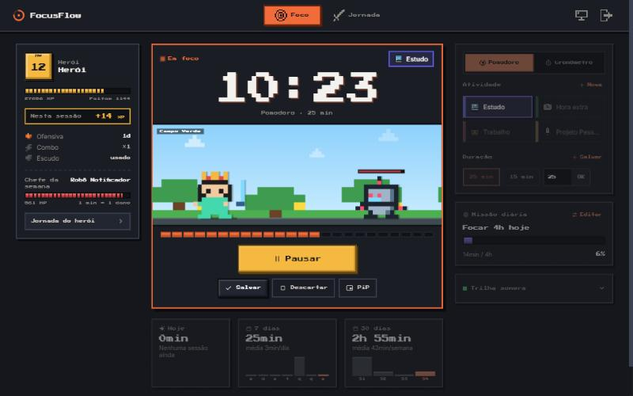
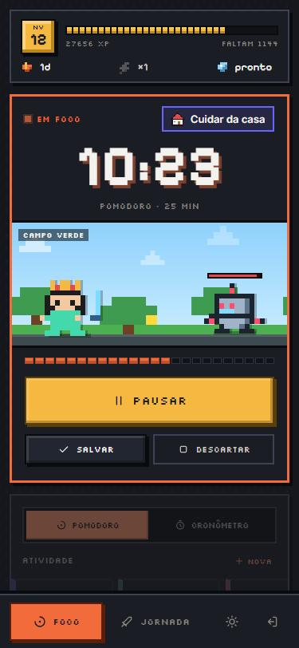
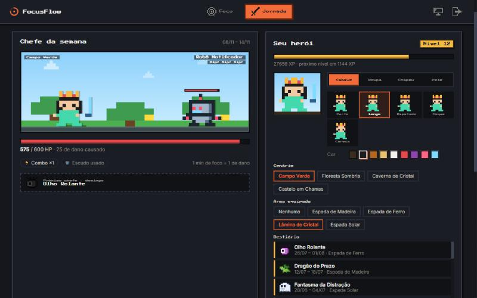
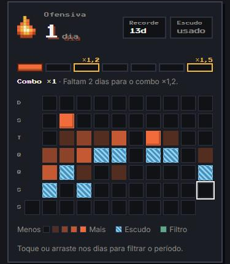
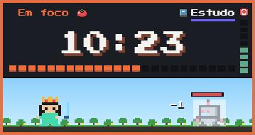
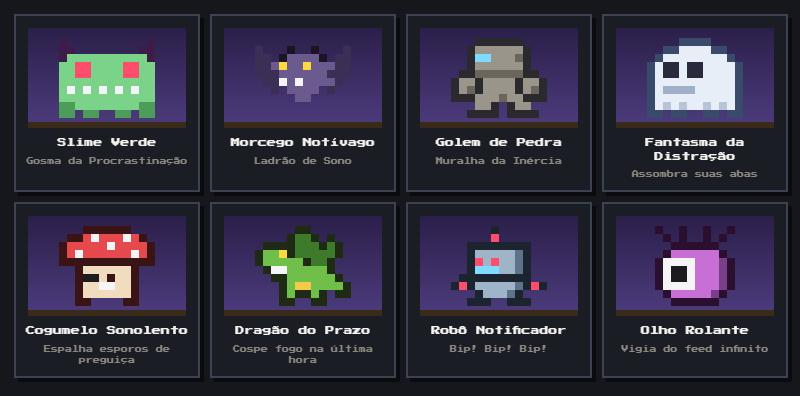

# FocusFlow

**A gamified focus timer where every minute of concentration is a hit on the weekly boss.**

Pomodoro and stopwatch sessions power a pixel-art RPG: your hero walks into battle while you focus, earns XP, levels up, unlocks gear and scenarios, and collects the monsters it defeats.



---

## How it works

```
Focus 1 minute  →  1 damage to the weekly boss (× combo)  →  XP for your hero
```

1. **Focus.** Pick an activity, start the timer. Your hero walks across the scenario while the clock runs.
2. **Hit the boss.** Every full minute lands a hit on the boss of the week. The damage floats up and its HP bar drops live.
3. **Evolve.** Damage becomes XP. Levels unlock outfits, headgear and new scenarios. Defeated bosses drop weapons and join your bestiary.

---

## Screenshots

| Focus mode (mobile) | Journey: boss, hero and bestiary |
|---|---|
|  |  |

| Streak, combo and heatmap | Picture-in-Picture |
|---|---|
|  |  |

---

## Features

### ⚔️ Weekly boss

- A new boss every week (Sunday to Saturday) with **600 HP**, which is 10 hours of focus.
- **8 monster species** rotate weekly, each with its own sprite and epithet. The next boss is shown as a silhouette.
- Defeating a boss drops a **weapon** for your hero and adds the monster to your **bestiary**.



### 🧙 Hero and progression

- **XP and levels:** all damage dealt becomes XP. Level *L* requires `200 × (L−1)²` XP.
- **Customization:** 5 hairstyles, 4 outfits (t-shirt, robe, cape, armor) and 6 pieces of headgear (cap, headband, helmet, wizard hat, crown…), plus hair, skin, shirt and pants colors.
- **Level unlocks:** outfits and headgear unlock as you level up, up to the crown at level 10. Locked items show as silhouettes with the level required.
- **Scenarios:** Campo Verde, Floresta Sombria (level 3), Caverna de Cristal (level 5) and Castelo em Chamas (level 8).

### 🔥 Streak, combo and shield

- **Streak:** consecutive days with at least one session.
- **Combo:** 3-day streak = ×1.2 damage, 7-day streak = ×1.5.
- **Shield:** one per week, covers a missed day so the streak survives.
- Weekly heatmap colored by daily focus time, with shield-covered days marked. Tap or drag across days to filter the journey stats.

### 🍅 Timer

- **Pomodoro** with saved presets (25, 50, 90 min…) or a custom duration, and a free **stopwatch** mode.
- Activities with color and pixel icon (Study, Work, Exercise… or your own).
- **Visual states:** the frame and scene change for focusing, paused (the hero dozes off) and finished (the hero celebrates with an XP burst).
- **Daily quest:** set a daily focus goal and track it as a bar split by activity, including the session in progress.
- Sound and system notification on completion, plus Spotify integration to play playlists while you focus.

### 🖼️ Picture-in-Picture

- A floating pixel-art window with the timer, a 24-segment progress bar, the daily goal and a mini stage where the hero keeps fighting the boss.
- Stays on top of other apps and browser tabs.

### 🎨 Pixel art design

- Custom design system: Pixelify Sans and Silkscreen typefaces, notched panels, hard shadows and segmented bars.
- **Own pixel icon set** (no system emojis), including an icon picker for activities.
- Light, dark and system themes. Responsive layouts for desktop, tablet and mobile.

### ☁️ Account, sync and PWA

- Email/password login with password reset.
- Sessions, goals, presets and your hero are stored in Cloud Firestore, so they follow you to any device.
- Installable as a desktop or mobile app (PWA).

---

## Tech Stack

| Layer | Technology |
|---|---|
| Framework | Angular 17 (Standalone Components) |
| State | Angular Signals |
| Auth & DB | Firebase Authentication + Cloud Firestore |
| Hosting | Firebase Hosting |
| PWA | @angular/pwa |
| Styling | SCSS (per component) with a shared pixel design system |
| Pixel art | Sprites defined as text grids, rendered to SVG (`crispEdges`) and Canvas |
| PiP | Canvas API + Picture-in-Picture API |

The game rules live in `src/app/core/game/`: XP and levels (`progress.ts`), streak and shield (`streak.ts`), weekly boss (`weekly-boss.ts`), sprites (`sprites.ts`), monsters and cosmetics (`game-data.ts`) and pixel icons (`pixel-icons.ts`).

---

## Run Locally

> This project's Firebase credentials are **not stored in the repository** to protect the author's account from unauthorized access and billing. To run locally, you'll need your own Firebase project (free tier is sufficient).

### 1. Create a Firebase project

1. Go to [console.firebase.google.com](https://console.firebase.google.com) and create a new project
2. Enable **Authentication** → Email/Password provider
3. Enable **Firestore Database** (test mode is fine)
4. Register a **Web App** and copy the config object

### 2. Set up environment

```sh
cp src/environments/environment.example.ts src/environments/environment.ts
```

Fill in `environment.ts` with your Firebase config:

```ts
export const environment = {
  production: false,
  firebase: {
    apiKey: "YOUR_FIREBASE_API_KEY",
    authDomain: "YOUR_FIREBASE_AUTH_DOMAIN",
    projectId: "YOUR_FIREBASE_PROJECT_ID",
    storageBucket: "YOUR_FIREBASE_STORAGE_BUCKET",
    messagingSenderId: "YOUR_FIREBASE_MESSAGING_SENDER_ID",
    appId: "YOUR_FIREBASE_APP_ID",
  },
  spotify: {
    clientId: "YOUR_SPOTIFY_CLIENT_ID",
    redirectUri: ""
  }
};
```

> `environment.ts` is in `.gitignore` — your credentials will never be committed.

### 3. Install and run

```bash
npm install
ng serve
```

To test the PWA (requires a production build):

```bash
ng build
npx serve dist/focusflow/browser
```

---

## CI / Deploy (GitHub Actions)

The workflow generates `environment.ts` from GitHub Secrets at build time. To deploy your own fork, add these secrets under **Settings → Secrets and variables → Actions**:

| Secret | Where to find it |
|---|---|
| `FIREBASE_API_KEY` | Firebase console → Project settings → Your app |
| `FIREBASE_AUTH_DOMAIN` | same |
| `FIREBASE_PROJECT_ID` | same |
| `FIREBASE_STORAGE_BUCKET` | same |
| `FIREBASE_MESSAGING_SENDER_ID` | same |
| `FIREBASE_APP_ID` | same |
| `FIREBASE_SERVICE_ACCOUNT_*` | Firebase console → Project settings → Service accounts → Generate new private key (also created automatically via `firebase init hosting`) |

---

## Browser Compatibility

| Browser | Support |
|---|---|
| Chrome / Edge | Full, including PiP |
| Firefox | Full (PiP support varies) |
| Safari | Full on macOS / iOS |

---

## License

MIT — feel free to fork and customize.
